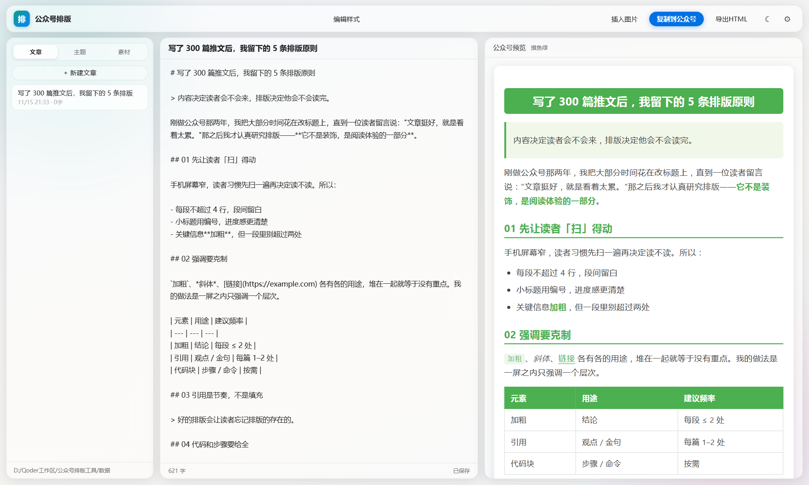
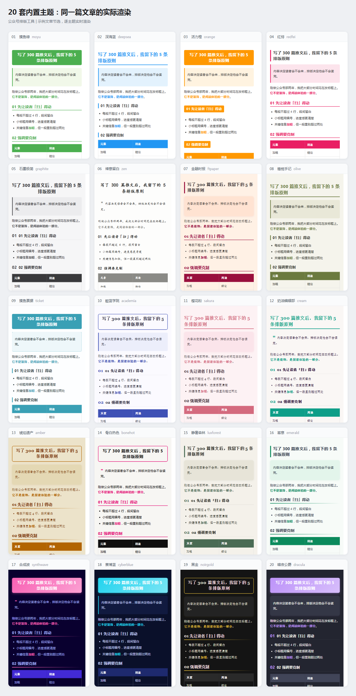
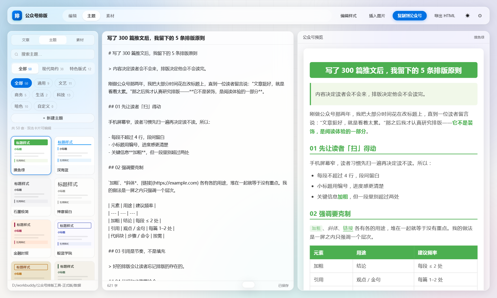
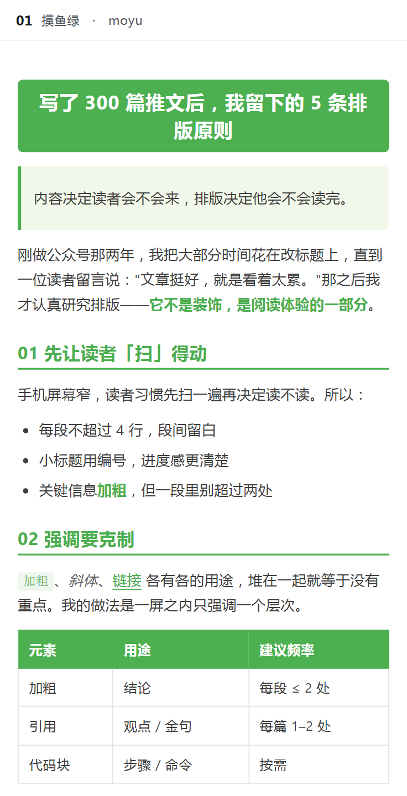
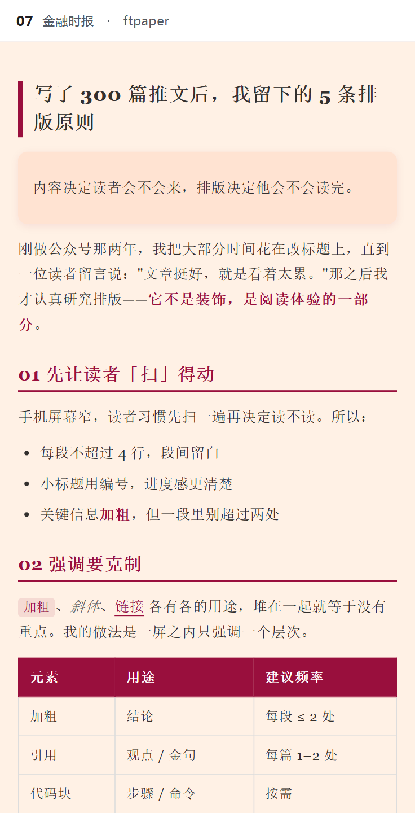
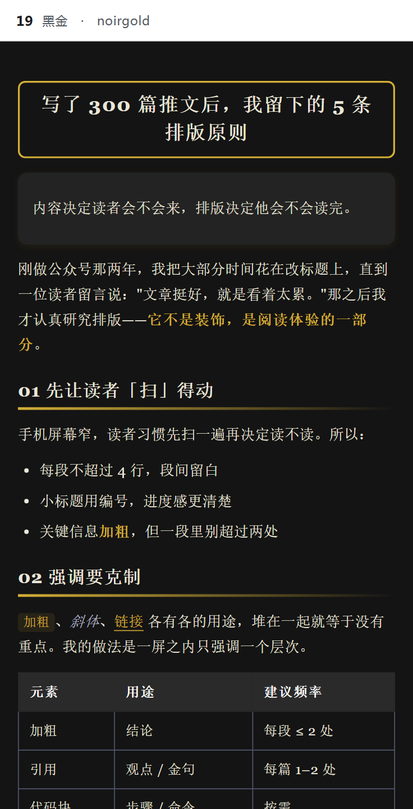
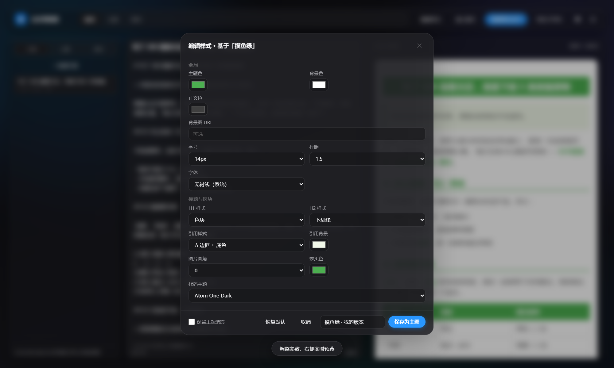
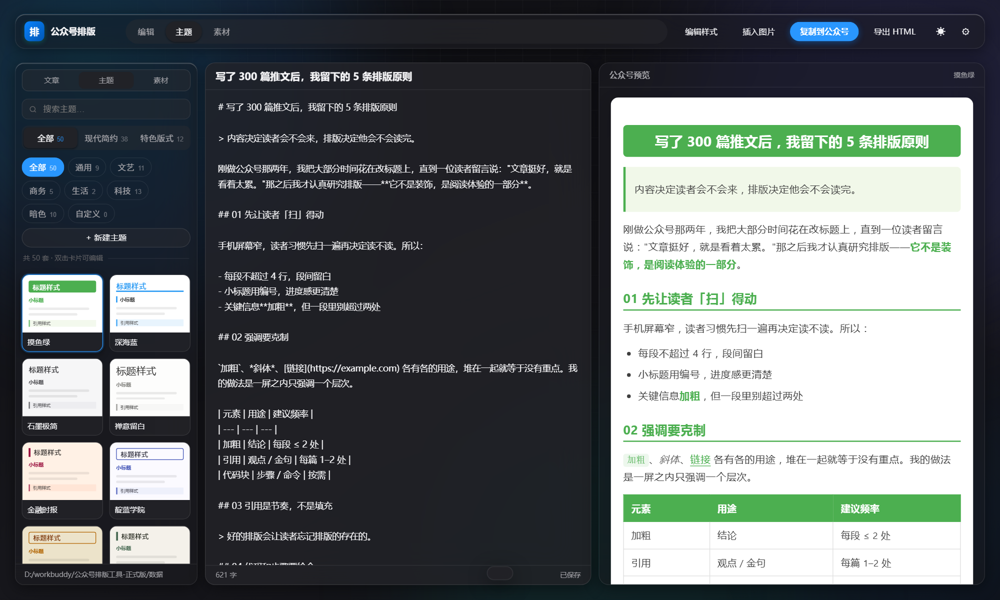

# 公众号排版工具 · WeChatMD

> 写 Markdown，一键得到能直接粘进微信公众号的排版。

一个给公众号博主用的 Electron 桌面工具：左边写 Markdown，右边实时预览公众号效果，**20 套内置排版主题**加自定义样式编辑器；点「复制到公众号」后，剪贴板里就是带完整内联样式的富文本，粘进后台即可发布。不联网也能用，文章、主题、素材全部存在本地。



## 它解决什么问题

微信公众号后台的编辑器会过滤 `<style>` 标签和大部分 class，只认写在标签上的 `style`。所以网页里做得再漂亮的排版，直接粘过去往往全乱。这个工具在导出时把每一条样式内联到每个标签上，并针对公众号编辑器做了专门变换（去掉 class/id、补齐继承样式、把有序列表改写成段落、给文本节点包 `<span leaf>` 等），**复制过去就是最终形态**。

| 能力 | 说明 |
| --- | --- |
| 实时预览 | 输入 Markdown 后 120 ms 防抖渲染，右侧即时显示公众号版式 |
| 20 套主题 | 从日常通用到暗色潮流，覆盖不同账号调性，点一下即切换 |
| 自定义样式 | 主色、背景、正文字号/行距/字体、H1/H2 样式、引用样式、代码配色、图片圆角等可视化编辑 |
| 一键复制 | 写入 `text/html` + `text/plain` 双格式剪贴板，粘贴即用 |
| 导出 HTML | 导出完整离线 HTML 文件，便于归档或二次处理 |
| 插入图片 | Catbox（免登录）/ SM.MS / ImgBB / 自定义图床，也支持直接填图片 URL |
| 本地存储 | 文章、主题、素材、设置都是本地 JSON 文件，无账号、无云同步 |
| 明暗界面 | 跟随系统或手动切换，编辑器与预览互不干扰 |

## 20 套内置主题

同一篇示例文章，逐主题实时渲染的效果总览：



侧栏的「主题」面板里可以直接点选，卡片本身就是该主题的缩略预览：



| # | 主题 | 风格 | 适合 |
| --- | --- | --- | --- |
| 01 | 摸鱼绿 `moyu` | 绿色色块标题、下划线小标题 | 日常通用、清单干货 |
| 02 | 深海蓝 `deepsea` | 蓝色下划线标题、左边框小标题 | 科技、职场 |
| 03 | 活力橙 `orange` | 橙色双色块标题 | 活动、促销、轻松话题 |
| 04 | 红绯 `redfei` | 玫红左边框标题 | 情感、美妆 |
| 05 | 石墨极简 `graphite` | 灰黑纯文字、数字序号 | 极简、深度长文 |
| 06 | 禅意留白 `zen` | 楷体、2.0 行距、引号引用 | 随笔、读书、散文 |
| 07 | 金融时报 `ftpaper` | 衬线体、米色纸感、卡片引用 | 财经、商业分析 |
| 08 | 橄榄手记 `olive` | 橄榄绿、米黄底 | 手记、生活方式 |
| 09 | 摸鱼票据 `ticket` | 青色、虚线票据引用 | 清单、攻略、测评 |
| 10 | 靛蓝学院 `academia` | 衬线体、描边标题、数字序号 | 教程、知识科普 |
| 11 | 樱花粉 `sakura` | 粉色衬线、卡片引用、大圆角图 | 生活方式、女性向 |
| 12 | 奶油编辑部 `cream` | 墨绿点缀、衬线体、引号引用 | 专栏、编辑部风格 |
| 13 | 琥珀遗产 `amber` | 琥珀描边标题、渐变下划线 | 人文、历史、书评 |
| 14 | 骨白热色 `bonehot` | 玫红描边、零圆角强对比 | 潮流、观点 |
| 15 | 静奢森林 `luxforest` | 深绿衬线、卡片引用 | 品牌、质感内容 |
| 16 | 翠意 `emerald` | 翠绿左边框、渐变小标题 | 自然、健康 |
| 17 | 合成波 `synthwave` | 深紫底、渐变标题（暗色） | 设计、潮流 |
| 18 | 赛博蓝 `cyberblue` | 深蓝底、青色渐变（暗色） | 数码、科技 |
| 19 | 黑金 `noirgold` | 黑底描边金框（暗色） | 商务、高端 |
| 20 | 暗夜公爵 `dracula` | Dracula 代码配色（暗色） | 技术、代码类文章 |

## 实际案例截图

下面用 [`examples/sample.md`](examples/sample.md) 这篇示例文章（含标题、引用、列表、表格、代码块）真实渲染，不是设计稿。完整的 20 张见 [`screenshots/`](screenshots)。

**摸鱼绿**：适合大多数日常推文



**金融时报**：衬线 + 纸感底色，适合深度长文



**黑金**：暗色强对比，适合观点类内容



## 自定义主题与暗色界面

「编辑样式」弹窗里能逐项调主题，调完保存即成为自己的主题，和内置的 20 套并列：



界面本身也支持明暗切换：



## 快速开始

需要 Node.js 20+。

```bash
npm install
npm start
```

打包成 Windows 便携版 / 安装包：

```bash
npm run dist
```

产物在 `out/`：`公众号排版工具-便携版.exe` 与 `公众号排版工具-安装版.zip`。

**不想装环境**：到 [Releases](https://github.com/Davin-96/wechat-md-typeset/releases/latest) 下载，两个版本都放在 Release 附件里：

- `WeChatMD-Portable-v1.0.0.exe` —— 便携版，双击即用、无需安装（约 106 MB，原名「公众号排版工具-便携版.exe」）
- `WeChatMD-Setup-v1.0.0.zip` —— 安装版压缩包，解压后按向导安装（约 146 MB，原名「公众号排版工具-安装版.zip」）

仓库里不放安装包：单个文件超过 GitHub 仓库 100 MB 上限，而 Release 附件上限是 2 GB。附件名使用 ASCII，是因为 GitHub 会把附件名里的中文字符规范化成 `-`（和仓库名一样）。

## 使用流程

1. 新建文章，在左侧写 Markdown（也支持直接粘贴已有文稿）
2. 在「主题」面板选一套样式，或点「编辑样式」自己调
3. 需要配图时点「插入图片」上传，或粘贴图片 URL
4. 点「复制到公众号」，到公众号后台正文里 `Ctrl+V`；也可「导出 HTML」留存

## 目录结构

```
src/
  main/            主进程：窗口、中文菜单、IPC、剪贴板、文件保存
    main.js
    preload.js      contextBridge 暴露的 window.api
    store.js        本地 JSON 存储
    image-upload.js 四种图床上传
  renderer/        渲染进程：编辑器 + 预览 + 主题系统
    index.html
    css/app.css
    js/boot.js      明暗模式初始化
    js/themes.js    20 套内置主题 + buildTheme()
    js/engine.js    Markdown → 公众号内联样式 HTML
    js/app.js       UI 与交互
    lib/            markdown-it、highlight.js（本地打包，无 CDN 依赖）
build/              应用图标
examples/sample.md  截图用的示例文章
screenshots/        界面截图 + 20 套主题案例图 + 总览
docs/ANALYSIS.md    完整技术拆解
```

完整的架构、主题生成、公众号适配变换与图床实现，见 [docs/ANALYSIS.md](docs/ANALYSIS.md)。

## 数据与隐私

- 数据目录默认是应用目录下的 `数据/`（便携版跟随 exe 所在目录），里面是明文 JSON：`文章/`、`主题.json`、`素材.json`、`设置.json`。该目录已被 `.gitignore` 排除，不会进仓库。
- 图床 Token（SM.MS / ImgBB / 自定义）保存在本地 `设置.json` 里。**请不要把该文件提交到任何公开仓库**，也不要在截图里露出 Token。
- Markdown 解析开启了 `html: false`，不会执行文稿里内嵌的 HTML。
- 仓库不含任何构建产物与 `node_modules`。

## License

MIT
